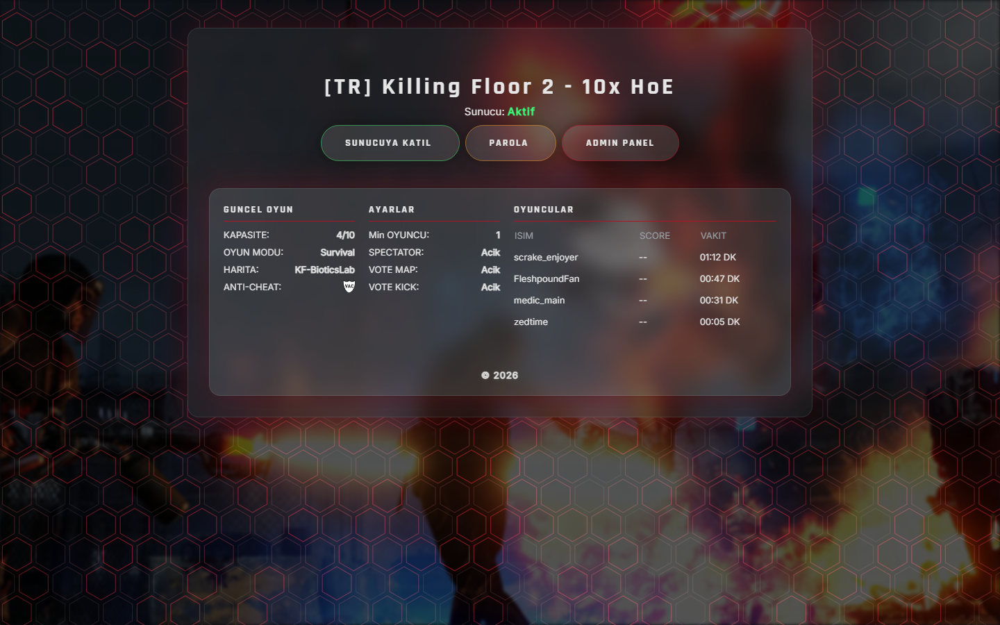
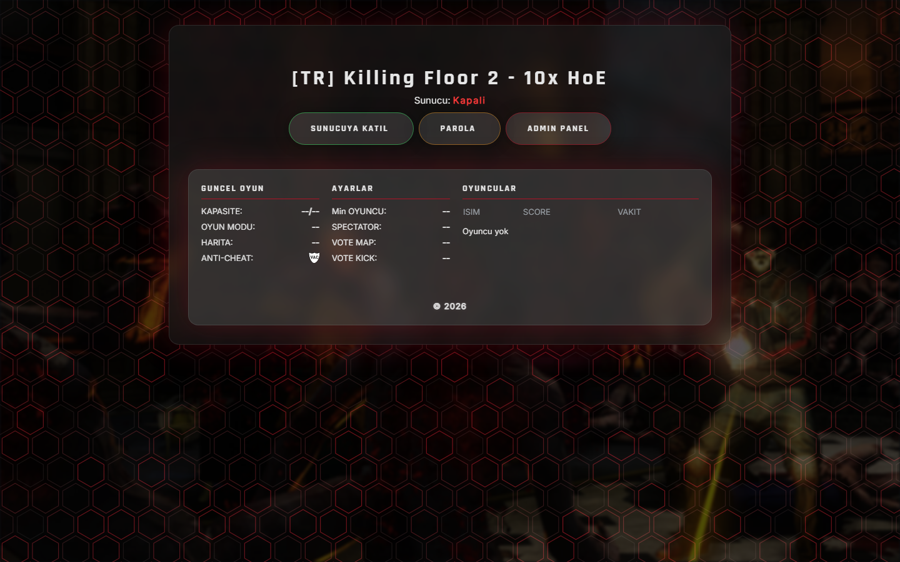
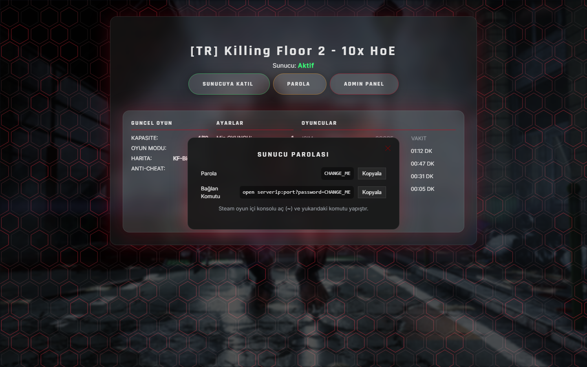
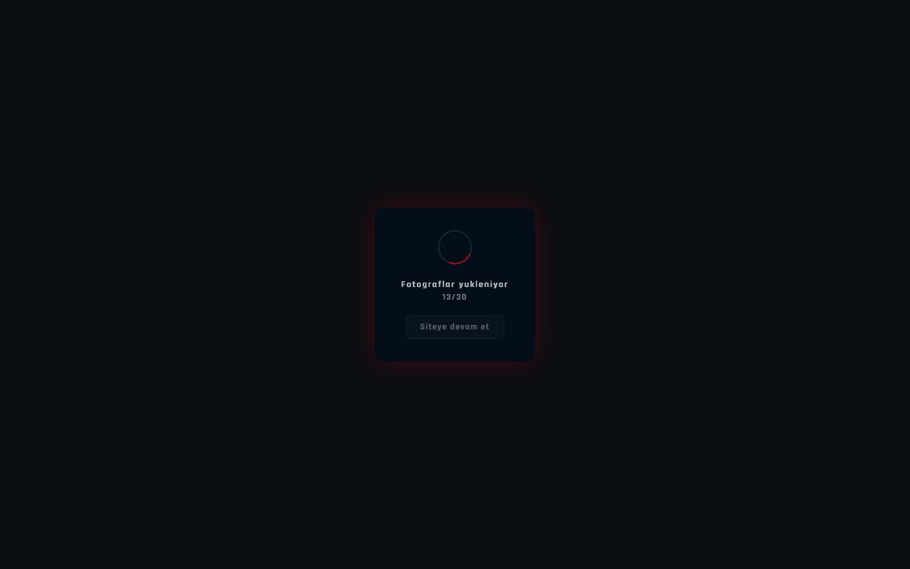
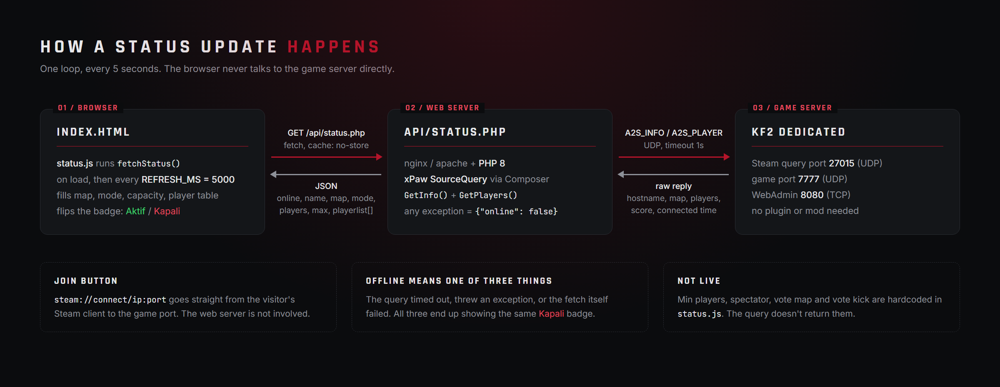
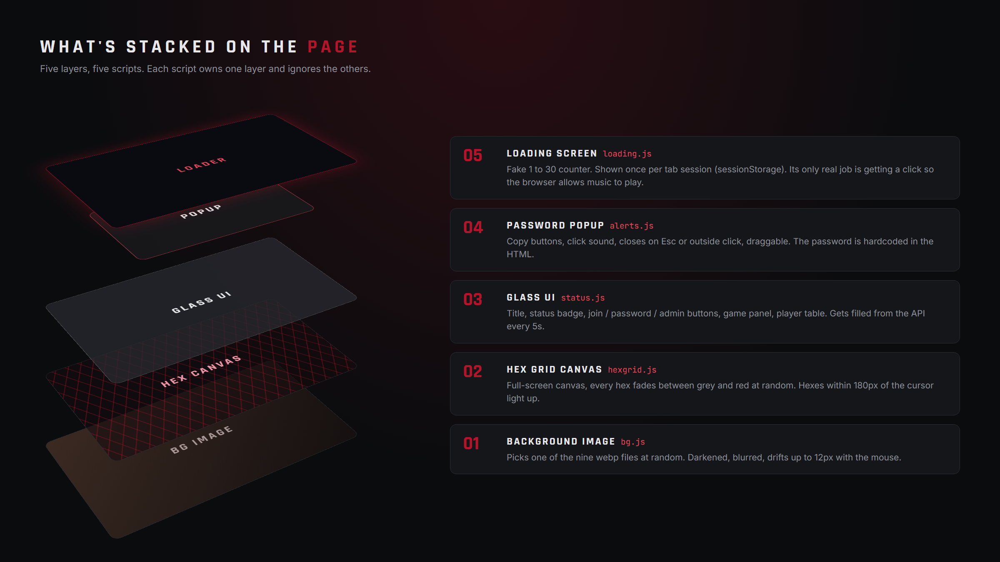

# kf2-server-status-page

A status page for a Killing Floor 2 server. It shows whether the server is up, what map is running, who's on it and for how long. It also has a join button and a password popup so people stop asking for the password in Discord.

Plain HTML, CSS, JS and one PHP file. No framework, no Node, no build step. Copy it to a web root and it runs.

The UI text is in Turkish. If you want another language, edit the strings in `index.html`, `js/status.js`, `js/loading.js` and `js/alerts.js`.



## What it does

- Queries the game server every 5 seconds and updates the page without a reload
- Shows the map, game mode, player count and a player table with score and time played
- Join button that hands off to Steam (`steam://connect/...`)
- Password popup with copy buttons for both the password and the full console `open` command
- Random background image with a slight mouse parallax, plus an animated hex grid on top
- One-time loading screen, which also serves as the click browsers require before they'll play background music

| Offline | Password popup | Loader |
|---|---|---|
|  |  |  |

## How it works



The browser never touches the game server. `js/status.js` calls `api/status.php`, which uses [xPaw's PHP-Source-Query](https://github.com/xPaw/PHP-Source-Query) to send a standard Steam A2S query over UDP to the server's query port. KF2 answers A2S out of the box, so nothing needs to be installed on the game server.

If the query times out (1 second), throws, or the fetch fails, the page shows the server as offline. It doesn't tell those three cases apart.

The "AYARLAR" panel (min players, spectators, vote map, vote kick) is **not live**. A2S doesn't return those values, so they're hardcoded in `showOnline()` in `js/status.js`. Change them to whatever your server actually uses.



Each script owns one layer:

| File | Job |
|---|---|
| `js/bg.js` | Picks a random `img/bg_*.webp`, darkens and blurs it, moves it a few pixels with the mouse |
| `js/hexgrid.js` | Full-screen canvas hex grid. Random grey to red fades, lights up near the cursor |
| `js/status.js` | Polls the API, fills in the panel and player table, sets the status badge |
| `js/alerts.js` | Password popup: open/close, Esc, outside click, drag, copy buttons |
| `js/loading.js` | Fake loading counter, once per tab session. The click on "continue" starts a random track from `audio/` |
| `api/status.php` | The only server-side code. Queries the game server, returns JSON |

## Requirements

- A web server that can run PHP 8 (nginx + PHP-FPM or Apache + mod_php)
- Composer, to install SourceQuery
- Outbound UDP from the web server to the game server's query port

## Install

Put the files in your web root:

```bash
git clone https://github.com/Yanoee/kf2-server-status-page.git /var/www/kf2
```

Install SourceQuery where `status.php` expects it (`api/sourcequery/vendor/autoload.php`):

```bash
cd /var/www/kf2/api
mkdir sourcequery && cd sourcequery
composer require xpaw/php-source-query-class
```

On Debian/Ubuntu, nginx and PHP:

```bash
apt update
apt install nginx php-fpm composer -y
```

Example server block. Check the PHP-FPM socket name against your installed version:

```nginx
server {
    listen 80;
    server_name status.example.com;

    root /var/www/kf2;
    index index.html;

    location / {
        try_files $uri $uri/ =404;
    }

    # vendor code has no business being reachable from the web
    location ^~ /api/sourcequery/ {
        deny all;
    }

    location ~ \.php$ {
        include snippets/fastcgi-php.conf;
        fastcgi_pass unix:/run/php/php8.2-fpm.sock;
    }

    location ~ /\. {
        deny all;
    }
}
```

```bash
nginx -t && systemctl reload nginx
```

Put TLS in front of it. Certbot takes two minutes.

## Configure

Nothing works until you replace the placeholders. All of them are plain text, so search for them.

| Where | What to change |
|---|---|
| `api/status.php` | `$SERVER_IP` and `$SERVER_PORT` (the query port, default `27015`) |
| `index.html` | `steam://connect/serverip:port` on the join button (game port, default `7777`) |
| `index.html` | Admin panel link (`serverip:port`, WebAdmin default `8080`). Better yet, remove it. See below |
| `index.html` | The password, in three places inside `#password-popup` |
| `index.html` | `` in the banner section. Add your own image or delete the section |
| `index.html` | Server title in the hero `<h1>` |
| `js/status.js` | Hardcoded rule values in `showOnline()` |
| `js/status.js` | `REFRESH_MS` if 5 seconds is too often or not often enough |

Backgrounds: drop `.webp` files in `img/` and update the `IMAGES` array in `js/bg.js`. They don't get picked up automatically.

Music: `audio/track1-3.mp3`, list in `js/loading.js`. Delete the tracks and the `tracks` array if you don't want music.

## API

`GET /api/status.php`

Online:

```json
{
  "online": true,
  "name": "My KF2 Server",
  "map": "KF-BioticsLab",
  "mode": "Survival",
  "players": 4,
  "max": 10,
  "playerlist": [
    { "Name": "someone", "Dosh": 18420, "Time": "01:12 DK" }
  ]
}
```

Offline:

```json
{ "online": false, "error": "..." }
```

It always returns HTTP 200. Check `online`, not the status code.

## Before you expose this

The page is public, and everything in it is public too.

- **The password is in the HTML.** Anyone can read it with view-source, so the popup only stops people who weren't going to look anyway. If the password actually matters, don't put it on a public page.
- **Don't link WebAdmin.** The admin button sends every visitor to your admin login. Remove it, or at minimum firewall port 8080 to your own IP.
- **`status.php` returns the raw exception message.** That can include your server's IP and port. Replace `$e->getMessage()` with a generic string if you care.
- **Player names are inserted with `innerHTML`.** Players choose their own names, so someone can name themselves with HTML and it runs on your page. Escape them or switch to `textContent` before you run this anywhere that matters.
- **Your server IP ends up in the page source** either way, through the connect link. That's how joining works. Just know it's there.

## Known issues

- **Score column always shows `--`.** The PHP sends `Dosh` and the JS reads `Kills`. Make them use the same key.
- Offline, error and timeout all look the same.
- The loading screen counts to 30 on a timer. It isn't measuring anything.
- Mobile has a breakpoint at 900px but hasn't been tested properly.

## Troubleshooting

**Always offline**

- Wrong query port. It's the Steam query port (`27015` by default), not the game port.
- UDP blocked somewhere between the web server and the game server. Test from the web server itself.
- SourceQuery not installed where the `require` expects it. Open `/api/status.php` directly and read the error.
- Server is running but hasn't finished loading a map yet.

**Online but no players**

- Nobody's playing.
- Players still on the loading screen don't always show up in A2S yet.

## License

MIT. See [LICENSE](LICENSE).
